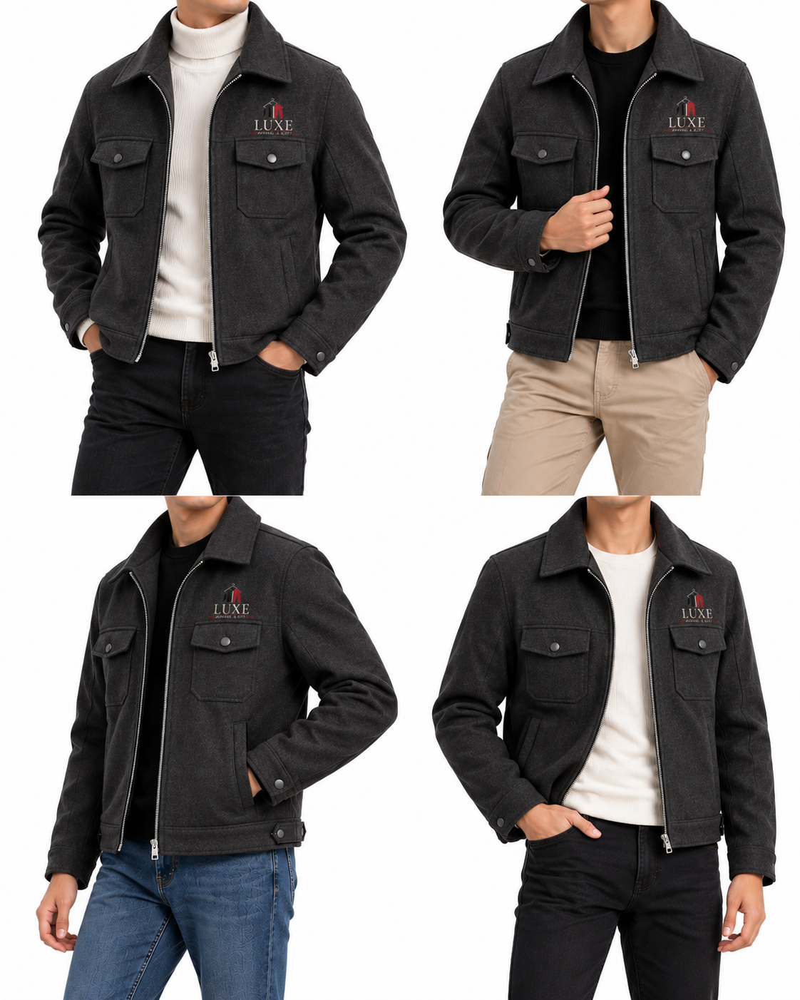

# Yo-Yo Cropper

Split 2×2 grid product images into 4 separate, numbered photos — right in your browser.

Drop in any number of grid images. Yo-Yo Cropper finds the cut lines for you, lets you fine-tune them, cleans up the background, resizes everything for your store, and hands you a ZIP of neatly numbered photos.

**100% client-side:** images never leave your machine. There is no upload, no backend, and no server cost.



---

## Table of contents

- [Features](#features)
- [How to use](#how-to-use)
- [Editing cut lines](#editing-cut-lines)
- [White eraser](#white-eraser)
- [Output settings](#output-settings)
- [File naming](#file-naming)
- [How it works](#how-it-works)
- [Tech stack](#tech-stack)
- [Project structure](#project-structure)
- [Getting started](#getting-started)
- [Deployment](#deployment)
- [Privacy](#privacy)
- [Troubleshooting](#troubleshooting)

---

## Features

- **Batch processing:** add as many grid images as you like by dropping, browsing, or pasting them (⌘/Ctrl + V).
- **Automatic cut-line detection:** finds the gutters between tiles, or the seam where tiles touch.
- **Independent vertical cuts:** the top and bottom rows each get their own vertical line, for grids that aren't perfectly aligned. Turn on **Straight line** to lock them together.
- **Precise editing:** drag lines with a 4× magnifier, or nudge them 1 px at a time with the arrow keys.
- **White eraser:** paint out stray spots, watermarks, or leftover grid lines with a brush or straight horizontal/vertical strokes.
- **Background cleanup:** keep the background, make it pure white, or make it transparent. The edge flood-fill leaves white clothing inside the product alone.
- **Store-ready sizing:** keep the original size, or use 1:1, 4:5, 3:4, 2:3, or an exact pixel size, with pad or fill. You can also set a max width or height.
- **File size limit:** set a per-photo KB budget, and quality, then dimensions, are reduced until each photo fits.
- **Live preview:** see the final 4 photos for any image, with their pixel size and KB, before you download.
- **Product grouping:** every *N* images (2 by default) count as one product, with optional folder-per-product output.
- **Download as a ZIP** or as individual files.
- **Settings are remembered** between visits (stored in `localStorage`).
- Light and dark themes, installable as a PWA, and reduced-motion aware.

## How to use

1. **Add images.** Drop grid images anywhere on the page, click **Add images**, or paste from the clipboard. Images are kept in the order you add them; use ↑ / ↓ on a card to reorder.
2. **Check the cut lines.** They're detected automatically. Adjust any line that's off (see [Editing cut lines](#editing-cut-lines)).
3. **Choose output settings** in the **Output settings** panel (naming, size, background, format).
4. Click **Preview** on a card to see the final photos (optional).
5. Click **Crop & download ZIP**, or **Files** to download each photo separately. Your browser may ask permission to allow multiple downloads.

The bottom bar shows a running total: `images → photos · products`. A product that is missing images gets a "needs N more images" badge.

## Editing cut lines

Each image has three cut lines:

| Line | Color | Moves |
| --- | --- | --- |
| Horizontal | Purple | Splits the top row from the bottom row |
| Vertical (top) | Amber | Splits the two top tiles |
| Vertical (bottom) | Amber | Splits the two bottom tiles |

- **Drag** a line to move it. A magnifier shows the area around the pointer at 4× while you drag.
- **Click** a line, then use the **arrow keys** to nudge it by 1 px, or 10 px with **Shift**.
- **Straight line** locks the top and bottom vertical cuts together.
- **Auto** resets to the detected positions.
- **Center** puts every line at exactly 50%.
- **Apply to all** copies this image's line positions to every image. This is handy when all your grids share the same layout.

Each quadrant shows the number its photo will get.

## White eraser

Click **Eraser** on a card to paint white over parts of the source image before it's cropped. Use it to remove dust, logos, or a thin grid line that bleeds into a tile.

- **Brush:** freehand.
- **Horizontal / Vertical:** straight strokes, ideal for erasing leftover divider lines.
- **Size:** 2–120 px (measured on screen and scaled to the full-resolution image).
- **Undo** removes the last stroke, **Clear** removes all strokes, and **Done** or **Esc** leaves eraser mode.

The cut lines can't be dragged while the eraser is active.

## Output settings

### Naming

| Setting | Description |
| --- | --- |
| **Folder per product** / **Continuous** | Choose the folder structure (see [File naming](#file-naming)). |
| **First product #** / **Start at** | The number to start counting from. |
| **Images / product** | How many grid images make up one product (default **2**, so 8 photos per product). |
| **Filename prefix** | Optional prefix such as `jacket-`. Characters that aren't valid in file names are stripped. |

### Size & shape

| Setting | Description |
| --- | --- |
| **Original** | Keep each tile's cropped size. |
| **1:1 · 4:5 · 3:4 · 2:3** | Force an aspect ratio. |
| **Exact** | A fixed pixel size (default **1000 × 1250**). |
| **Pad with white** | Fit the whole tile and fill the remaining space with white (or transparency). |
| **Fill (crop edges)** | Fill the frame and trim whatever overflows. |
| **Max width / height** | Scale down any photo that's larger. Leave empty for no limit. |

### Background

| Setting | Description |
| --- | --- |
| **Keep** | Leave the background as it is. |
| **Pure white** | Replace the detected background color with `#FFFFFF`. |
| **Transparent** | Remove the background. JPG output is switched to PNG automatically. |
| **Strength** | Color tolerance (10–160). Raise it if grey shadows remain; lower it if product edges get eaten. |
| **Auto-trim empty space** | Shrink each tile to its content, with optional padding in px. |

### Format & file size

| Setting | Description |
| --- | --- |
| **Original · PNG · JPG · WebP** | Output format. **Original** keeps the source format (falling back to PNG for unsupported types). |
| **Quality** | 50–100, for JPG and WebP only. |
| **Max file size per photo (KB)** | The size budget. For JPG/WebP, quality is lowered first (binary search down to 0.4), then dimensions. PNG is lossless, so only dimensions shrink. In **Exact** size mode the dimensions are never changed. |

Click **Output settings** to collapse the panel; it then shows a one-line summary of the current choices.

## File naming

Tiles are numbered in reading order: **top-left → top-right → bottom-left → bottom-right**.

**Folder per product** (default; 2 images per product):

```
yoyo-cropper-2026-10-25-14-30.zip
├── product-01/
│   ├── 1.jpg … 4.jpg     ← image 1
│   └── 5.jpg … 8.jpg     ← image 2
├── product-02/
│   └── 1.jpg … 8.jpg     ← images 3 & 4
└── …
```

**Continuous:**

```
1.jpg 2.jpg 3.jpg 4.jpg   ← image 1
5.jpg 6.jpg 7.jpg 8.jpg   ← image 2
…
```

With a prefix such as `jacket-`, names become `jacket-product-01/jacket-1.jpg` or `jacket-1.jpg`. When you use **Files** instead of the ZIP, the folder separator becomes `_` (`product-01_1.jpg`).

## How it works

All image processing lives in [`lib/image.ts`](lib/image.ts) and runs on HTML `<canvas>`.

1. **Background estimation:** the per-channel median of the image's border pixels.
2. **Line detection** (`detectLines`): the image is downsampled to a maximum of 1200 px. In the middle 30–70% band, the code looks for the widest run of rows (or columns) that are almost entirely background, which is the gutter. If there's no gutter because the tiles touch, it falls back to the strongest color seam in the 40–60% band. If that fails too, it uses the exact center. The horizontal line is found first, then each row's vertical line separately.
3. **Eraser:** strokes are painted in white onto a full-resolution copy of the source.
4. **Per-tile pipeline** (`processTile`):
   1. crop, plus optional auto-trim to the content bounds
   2. background cleanup: a flood-fill from the tile edges through background-colored pixels, with soft alpha or white blending at the boundary
   3. reshape to the target aspect ratio or exact size (pad or fill)
   4. apply the max width / height limits (multi-step halving keeps downscaling sharp)
   5. encode to the target format, shrinking quality and then dimensions to meet the KB limit
5. **Packaging:** the files are zipped with [JSZip](https://stuk.github.io/jszip/) (`STORE`, since the images are already compressed) and downloaded as a Blob.

## Tech stack

- [Next.js 16](https://nextjs.org/) (App Router, Turbopack)
- [React 19](https://react.dev/)
- [TypeScript](https://www.typescriptlang.org/)
- [Tailwind CSS 4](https://tailwindcss.com/)
- [Motion](https://motion.dev/) for animations
- [JSZip](https://stuk.github.io/jszip/) for ZIP creation
- [Geist](https://vercel.com/font) font

## Project structure

```
.
├── app/
│   ├── layout.tsx            # Root layout, metadata, fonts, theme color
│   ├── page.tsx              # Main page: upload, product grouping, download, hero
│   ├── globals.css           # Theme tokens (light/dark), glass, dropzone styles
│   ├── manifest.ts           # PWA manifest
│   ├── icon.svg              # Favicon
│   ├── apple-icon.tsx        # Generated Apple touch icon
│   └── opengraph-image.tsx   # Generated social preview image
├── components/
│   ├── ImageCard.tsx         # Per-image card: toolbar, eraser panel, live preview
│   ├── SplitEditor.tsx       # Draggable cut lines, magnifier, eraser canvas
│   ├── SettingsPanel.tsx     # Output settings panel
│   ├── ui.tsx                # Button, Segmented, Switch, Field, motion springs
│   ├── icons.tsx             # Inline SVG icons
│   └── Logo.tsx
├── lib/
│   ├── image.ts              # Detection, cropping, background cleanup, resize, encode
│   └── settings.ts           # Settings and Item types, defaults, option mapping
├── sample.png                # Example 2×2 grid for testing
├── next.config.ts
├── postcss.config.mjs
└── tsconfig.json
```

## Getting started

### Prerequisites

- **Node.js 20.9 or later**
- npm (or a package manager of your choice)

### Install and run

```bash
git clone https://github.com/ratulhasan001/automated-image-cropper.git
cd automated-image-cropper
npm install
npm run dev
```

Open <http://localhost:3000> and drop in `sample.png` to try it out.

### Scripts

| Command | Description |
| --- | --- |
| `npm run dev` | Start the development server |
| `npm run build` | Create a production build |
| `npm run start` | Serve the production build |

## Deployment

The app needs no environment variables, database, or server-side code, so it runs on any Node host that supports Next.js.

### Vercel

- Push the repo to GitHub, choose **Add New Project** on [vercel.com](https://vercel.com), and import it. No settings are needed.
- Or deploy from the CLI:

  ```bash
  npx vercel          # preview deployment
  npx vercel --prod   # production
  ```

### Other hosts

```bash
npm run build
npm run start   # serves on port 3000 (set PORT to change it)
```

## Privacy

Every step (decoding, detection, cropping, background removal, encoding, and zipping) happens locally in your browser through the Canvas API. No image data is sent anywhere. The only things saved are your output settings, kept in your browser's `localStorage` under the key `grid-cropper-settings`.

## Troubleshooting

| Problem | Fix |
| --- | --- |
| A line was detected in the wrong place | Drag it into place, or click **Center**. If all grids share a layout, fix one and click **Apply to all**. |
| Grey shadows remain after **Pure white** or **Transparent** | Raise **Strength**. |
| Product edges get eaten by background removal | Lower **Strength**, and check with **Preview**. |
| A thin divider line shows at a tile's edge | Nudge the cut line by 1–2 px, or use the eraser in **Horizontal** / **Vertical** mode. |
| A photo is still over the KB limit | Switch to JPG/WebP, or leave **Exact** mode so the dimensions can shrink. |
| **Files** only downloaded one photo | Allow multiple downloads for the site in your browser, or use the ZIP. |
| Transparent output came out as PNG | JPG can't store transparency, so those photos are saved as PNG on purpose. |
